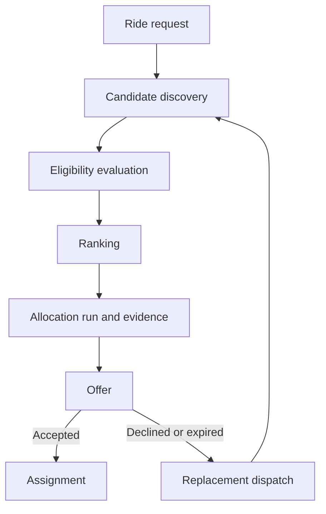

# Ride Dispatch

[](https://github.com/Sye-1321/ride-dispatch/actions/workflows/ci.yml)

Ride Dispatch is an ASP.NET Core service for deciding which eligible driver should receive a ride request and preserving the evidence behind that decision.

## Overview

The service manages a ride-to-driver dispatch lifecycle. Candidate discovery is eligibility-first: drivers are selected within a geographic radius, evaluated against operational and business rules, and only then ranked. An allocation run persists the recommendation and the candidate evidence used to produce it, making the decision inspectable later.

The lifecycle continues through time-limited offers and accepted-offer assignments. It also supports dispatcher selection of a different eligible candidate, replacement dispatch after a declined or expired offer, and explicit activation of scheduled rides.

## Dispatch model



The eligible-driver endpoint performs the discovery, evaluation, and ranking stages without persisting an allocation run. Creating an allocation run records the result for use by the rest of the lifecycle.

## Candidate eligibility

PostgreSQL/PostGIS performs candidate discovery within the configured distance of the ride pickup. Each discovered candidate is then evaluated for:

- approved driver status;
- operational availability;
- a recorded availability timestamp;
- presence of a registered vehicle;
- an exact match to the ride's required vehicle type;
- location freshness;
- recorded financial standing;
- the minimum commission balance;
- overlapping active assignments during the ride occupancy window;
- a previous declined offer for the same ride; and
- a previous expired offer for the same ride.

A rejected candidate can have multiple rejection reasons. Allocation runs persist all applicable reasons for discovered candidates rather than stopping at the first failed rule.

`GET /api/v1/ride-requests/{id}/eligible-drivers` is a read-only diagnostic view. It returns the currently eligible drivers in ranked order but does not create an allocation run or persist candidate evidence.

## Ranking and allocation runs

Two ranking policies are implemented:

| Policy | Primary order | Tie-breakers |
| --- | --- | --- |
| `NEAREST` | Shortest pickup distance | Earlier availability, then driver ID |
| `LONGEST_IDLE` | Earliest availability timestamp | Shorter distance, then driver ID |

The explicit tie-breakers make both policies deterministic.

An allocation run persists:

- the ride request;
- the ranking policy;
- the recommended driver, when an eligible candidate exists;
- its creation timestamp;
- an evaluation for every discovered candidate;
- the rank assigned to each eligible candidate;
- all rejection reasons for each ineligible candidate; and
- the source offer when the run was created as a replacement.

This evidence represents the dispatch decision at that point in time. Reading it later does not reevaluate candidates against current driver or ride state.

## Offers, override, and replacement

### Recommended offers

An allocation run can have at most one offer. The offer TTL is configurable, and each offer stores its creation and expiry timestamps. Offer status is one of `PENDING`, `ACCEPTED`, `DECLINED`, `EXPIRED`, or `WITHDRAWN`. Expiry is evaluated against the persisted expiry timestamp when relevant offer workflows execute.

### Dispatcher override

A dispatcher override changes which already-eligible candidate receives the offer; it does not bypass eligibility. The selected driver must:

- appear in the allocation run's persisted candidate evidence;
- have been eligible in that evidence; and
- differ from the normal recommended driver.

A non-empty reason is required and persisted after trimming. The recommendation, selected driver, selection mode, reason, candidate evidence, and timestamps retain the decision context. The service does not record an operator identity.

### Replacement dispatch

A declined or expired offer can initiate replacement dispatch. A pending offer whose expiry time has elapsed is first marked expired by this workflow. The replacement allocation run links to its source offer and reuses the normal eligibility and ranking process.

A unique source-offer relationship makes retries converge on the existing replacement run. If that run has a recommendation, the workflow likewise reuses or creates its single offer. Repeating the process from a later failed offer can form a replacement chain.

## Scheduled rides

Ride timing is either `IMMEDIATE` or `SCHEDULED`. An immediate ride has no requested pickup time. A scheduled ride requires one.

Scheduled dispatch must be activated explicitly before an allocation run can be created. Activation is persisted and is allowed from the requested pickup time minus the configured lead time through the pickup timestamp. The default lead time is 15 minutes. Concurrent activation attempts are retry-safe and return the persisted activation when another request wins the race.

The eligible-driver preview remains available independently of activation. It evaluates candidates for the scheduled ride's occupancy window without creating an allocation run.

## Assignments and schedule protection

Assignments can be created only from accepted offers. Their occupancy window is derived as follows:

- immediate rides start at the current time;
- scheduled rides start at the requested pickup time; and
- the ride's estimated trip duration determines the end time.

An `ACTIVE` assignment reserves the driver's schedule. A `COMPLETED` assignment retains the completed ride but no longer reserves the schedule. A `CANCELLED` assignment releases both the driver reservation and the ride for a later non-cancelled assignment.

PostgreSQL protects active driver schedules with an exclusion constraint over overlapping `tstzrange` values. Application prechecks provide an early conflict response, while the database constraint handles concurrent writes. The database also enforces one assignment per offer and at most one non-cancelled assignment per ride.

## Database-backed invariants

EF Core mappings and PostgreSQL constraints enforce the central persistence rules:

- driver locations use PostGIS `geography(Point, 4326)` with a GiST spatial index;
- an exclusion constraint prevents overlapping active assignment windows for a driver;
- each driver can have at most one vehicle;
- each allocation run can have at most one offer;
- each offer can have at most one assignment;
- each ride can have at most one non-cancelled assignment;
- each source offer can have at most one replacement allocation run;
- eligible candidate evaluations require a positive rank, while rejected candidates cannot have one;
- offer status, resolution timestamps, selection mode, and override reasons must remain consistent;
- scheduled pickup and activation timestamps must match the ride timing rules; and
- assignment status and scheduled activation fields act as concurrency tokens for their respective updates.

## Architecture

```text
src/
  RideDispatch.Api
  RideDispatch.Application
  RideDispatch.Domain
  RideDispatch.Infrastructure

tests/
  RideDispatch.UnitTests
  RideDispatch.IntegrationTests
```

Project dependencies flow inward:

```text
Api             -> Application + Infrastructure
Infrastructure  -> Application + Domain
Application     -> Domain
Domain          -> no project dependencies
```

- **Domain** defines state transitions and entity invariants.
- **Application** contains use cases, dispatch policies, ranking, and orchestration.
- **Infrastructure** implements EF Core persistence with PostgreSQL and PostGIS.
- **API** provides HTTP transport, dependency composition, health checks, and OpenAPI generation.

## API overview

JSON enum values use uppercase snake case, such as `LONGEST_IDLE` and `DISPATCHER_OVERRIDE`.

### Ride requests and dispatch

| Method | Route | Purpose |
| --- | --- | --- |
| `POST` | `/api/v1/ride-requests` | Create a ride request |
| `GET` | `/api/v1/ride-requests` | List ride requests |
| `GET` | `/api/v1/ride-requests/{id}` | Get a ride request |
| `POST` | `/api/v1/ride-requests/{id}/activate-dispatch` | Activate a scheduled ride for dispatch |
| `GET` | `/api/v1/ride-requests/{id}/eligible-drivers` | Preview ranked eligible drivers |
| `POST` | `/api/v1/ride-requests/{id}/allocation-runs` | Create and persist an allocation decision |
| `GET` | `/api/v1/allocation-runs/{id}` | Get an allocation run |
| `GET` | `/api/v1/allocation-runs/{id}/candidate-evaluations` | Get persisted candidate evidence |

The eligible-driver and allocation-run creation routes accept an optional `rankingPolicy` query parameter. The default is `NEAREST`.

### Offers and assignments

| Method | Route | Purpose |
| --- | --- | --- |
| `POST` | `/api/v1/allocation-runs/{id}/offers` | Offer the ride to the recommended driver |
| `POST` | `/api/v1/allocation-runs/{id}/offers/override` | Offer the ride to another persisted eligible candidate |
| `GET` | `/api/v1/offers/{id}` | Get an offer |
| `POST` | `/api/v1/offers/{id}/accept` | Accept a pending offer |
| `POST` | `/api/v1/offers/{id}/decline` | Decline a pending offer |
| `POST` | `/api/v1/offers/{id}/withdraw` | Withdraw a pending offer |
| `POST` | `/api/v1/offers/{id}/replacement-dispatch` | Dispatch a replacement after decline or expiry |
| `POST` | `/api/v1/offers/{id}/assignments` | Create an assignment from an accepted offer |
| `GET` | `/api/v1/assignments/{id}` | Get an assignment |
| `POST` | `/api/v1/assignments/{id}/complete` | Complete an active assignment |
| `POST` | `/api/v1/assignments/{id}/cancel` | Cancel an active assignment |

### Driver and passenger setup

| Method | Route | Purpose |
| --- | --- | --- |
| `POST` | `/api/v1/drivers` | Create a driver |
| `GET` | `/api/v1/drivers` | List drivers |
| `GET` | `/api/v1/drivers/{id}` | Get a driver |
| `PUT` | `/api/v1/drivers/{id}/approval` | Change driver approval |
| `PUT` | `/api/v1/drivers/{id}/operational-status` | Change operational status |
| `POST` | `/api/v1/drivers/{id}/vehicle` | Register the driver's vehicle |
| `GET` | `/api/v1/drivers/{id}/vehicle` | Get the driver's vehicle |
| `PUT` | `/api/v1/drivers/{id}/location` | Update driver location |
| `GET` | `/api/v1/drivers/{id}/location` | Get driver location |
| `GET` | `/api/v1/drivers/nearby` | Search for drivers by location and radius |
| `PUT` | `/api/v1/drivers/{id}/financial-standing` | Update commission balance |
| `GET` | `/api/v1/drivers/{id}/financial-standing` | Get commission standing |
| `POST` | `/api/v1/passengers` | Create a passenger |
| `GET` | `/api/v1/passengers/{id}` | Get a passenger |

## Configuration

The following values are defaults from `src/RideDispatch.Api/appsettings.json`, not universal business rules:

| Setting | Default | Meaning |
| --- | ---: | --- |
| `Dispatch:Eligibility:MaxRadiusMeters` | `50000` | Maximum candidate-discovery distance from pickup |
| `Dispatch:Eligibility:LocationFreshnessSeconds` | `60` | Maximum age of an eligible driver location |
| `Dispatch:Eligibility:MinimumCommissionBalance` | `0.01` | Minimum eligible commission balance |
| `Dispatch:Offers:TtlSeconds` | `20` | Lifetime of a pending offer |
| `Dispatch:Scheduled:ActivationLeadTimeSeconds` | `900` | Earliest scheduled activation before pickup |

The database connection string is required as `ConnectionStrings:Database`. Development settings point to the database defined by `compose.yaml`.

## Local development

Prerequisites:

- the .NET SDK declared by `global.json`;
- Docker with Compose support; and
- PostgreSQL/PostGIS, supplied locally by `compose.yaml`.

Start the database, restore dependencies and tools, apply migrations, and run the API:

```bash
docker compose up -d database
dotnet tool restore
dotnet restore
dotnet ef database update --project src/RideDispatch.Infrastructure --startup-project src/RideDispatch.Api
dotnet run --project src/RideDispatch.Api
```

The default HTTP launch profile listens on `http://localhost:5233`. In the Development environment, the generated OpenAPI document is exposed at `/openapi/v1.json`; no interactive documentation UI is configured.

Health endpoints are available independently of the OpenAPI document:

- `GET /health/live` reports process liveness without running registered dependency checks.
- `GET /health/ready` includes the database context health check.

## Tests

The repository contains focused unit tests and PostgreSQL/PostGIS integration tests. Integration tests use Testcontainers to start real database instances. The CI workflow builds the solution and runs the two suites separately.

The currently verified suite contains 244 unit tests and 39 integration tests, for 283 tests in total.

```bash
dotnet test tests/RideDispatch.UnitTests/RideDispatch.UnitTests.csproj
dotnet test tests/RideDispatch.IntegrationTests/RideDispatch.IntegrationTests.csproj
```

## Design boundaries

This service focuses on dispatch and allocation correctness rather than the full ride lifecycle. Authentication and authorization, routing and ETA calculation, and live driver transport or streaming are not implemented here.

There is no background offer-expiry worker. Expiry is evaluated when an offer transition or replacement-dispatch workflow needs the current offer state. The service uses direct application orchestration and database constraints; it does not introduce an event bus or separate services for the current consistency boundaries.
