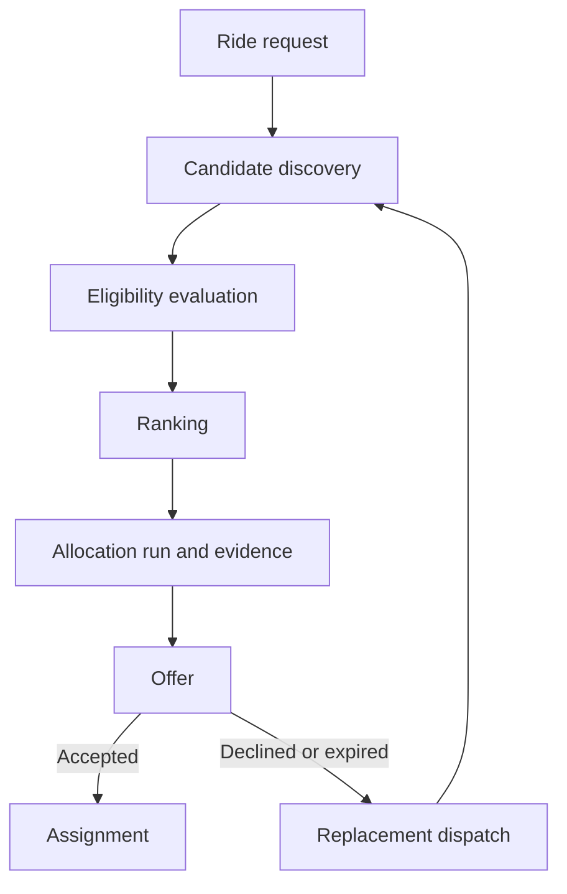

# Ride Dispatch

[](https://github.com/Sye-1321/ride-dispatch/actions/workflows/ci.yml)

Ride Dispatch is an ASP.NET Core service for deciding which eligible driver should receive a ride request and preserving the evidence behind that decision.

## Overview

Drivers are discovered using PostGIS, evaluated against eligibility rules, and ranked by distance or time spent available. Allocation runs record recommendations, candidate ranks, and rejection reasons.

The service supports time-limited offers, dispatcher overrides, replacement dispatch, scheduled rides, and driver assignments.

## Dispatch model



## Candidate eligibility

PostgreSQL/PostGIS performs candidate discovery within the configured distance of the ride pickup. Each discovered candidate is then evaluated for:

- approved driver status;
- operational availability;
- a recorded availability timestamp;
- presence of a registered vehicle;
- an exact match to the ride's required vehicle type;
- location freshness;
- recorded financial standing;
- the minimum commission balance;
- overlapping active assignments during the ride occupancy window;
- a previous declined offer for the same ride; and
- a previous expired offer for the same ride.

Allocation runs record all applicable rejection reasons for each candidate.

`GET /api/v1/ride-requests/{id}/eligible-drivers` is a read-only diagnostic view. It returns the currently eligible drivers in ranked order but does not create an allocation run or persist candidate evidence.

## Ranking and allocation runs

Two ranking policies are implemented:

| Policy | Primary order | Tie-breakers |
| --- | --- | --- |
| `NEAREST` | Shortest pickup distance | Earlier availability, then driver ID |
| `LONGEST_IDLE` | Earliest availability timestamp | Shorter distance, then driver ID |

The explicit tie-breakers make both policies deterministic.

An allocation run persists:

- the ride request;
- the ranking policy;
- the recommended driver, when an eligible candidate exists;
- its creation timestamp;
- an evaluation for every discovered candidate;
- the rank assigned to each eligible candidate;
- all rejection reasons for each ineligible candidate; and
- the source offer when the run was created as a replacement.

Allocation runs retain the original decision evidence without reevaluating candidates when retrieved.

## Offers, override, and replacement

### Recommended offers

Each allocation run can have at most one offer. An unexpired `PENDING` offer or an `ACCEPTED` offer blocks further offers for the same ride. `DECLINED`, `WITHDRAWN`, and `EXPIRED` offers do not. Accepted offers remain blocking after assignment cancellation or completion.

Relevant offer workflows mark elapsed pending offers as expired. Offer lifetime is configurable, and creation and expiry timestamps are stored. Optimistic concurrency protects status transitions; a losing request reloads and returns the persisted state.

### Dispatcher override

A dispatcher may select a different driver recorded as eligible in the allocation run. Eligibility is based on that run's saved evaluation, not a new evaluation at offer creation.

A non-empty, trimmed reason is required and stored. The original recommendation, selected driver, selection mode, reason, candidate evidence, and timestamps are retained. The service does not record an operator identity.

### Replacement dispatch

Declined or expired offers can initiate replacement dispatch using the same eligibility and ranking process. Elapsed pending offers are marked expired first.

Each replacement run links uniquely to its source offer. Retries reuse the existing run and, if it has a recommendation, reuse or create its single offer. Later failed offers can form a replacement chain.

## Scheduled rides

`IMMEDIATE` rides have no requested pickup time; `SCHEDULED` rides require one.

Scheduled dispatch must be activated explicitly before an allocation run can be created. Activation is persisted and is allowed from the requested pickup time minus the configured lead time through the pickup timestamp. The default lead time is 15 minutes. Concurrent activation attempts are retry-safe and return the persisted activation when another request wins the race.

New scheduled allocation runs, offers, and replacement runs cannot be initiated after the pickup timestamp. The pickup timestamp itself is allowed. Existing replacement offers remain retrievable, and operations admitted before the cutoff may finish.

The eligible-driver preview remains available independently of activation. It evaluates candidates for the scheduled ride's occupancy window without creating an allocation run.

## Assignments and schedule protection

Assignments can be created only from accepted offers. Their occupancy window is derived as follows:

- immediate rides start at the current time;
- scheduled rides start at the requested pickup time; and
- the ride's estimated trip duration determines the end time.

| Status | Schedule behavior |
| --- | --- |
| `ACTIVE` | Reserves the driver's occupancy window |
| `COMPLETED` | Releases the driver's schedule but retains the completed assignment |
| `CANCELLED` | Releases the driver's schedule and the ride's non-cancelled assignment slot |

PostgreSQL protects active driver schedules with an exclusion constraint over overlapping `tstzrange` values. Application prechecks provide an early conflict response, while the database constraint handles concurrent writes. The database also enforces one assignment per offer and at most one non-cancelled assignment per ride.

## Database-backed invariants

EF Core mappings and PostgreSQL constraints enforce the central persistence rules:

- driver locations use PostGIS `geography(Point, 4326)` with a GiST spatial index;
- an exclusion constraint prevents overlapping active assignment windows for a driver;
- each driver can have at most one vehicle;
- unique indexes allow at most one offer per allocation run and one persisted `PENDING` or `ACCEPTED` offer per ride;
- unique indexes allow at most one assignment per offer and one non-cancelled assignment per ride;
- each source offer can have at most one replacement allocation run;
- eligible candidate evaluations require a positive rank, while rejected candidates cannot have one;
- offer status, resolution timestamps, selection mode, and override reasons must remain consistent;
- scheduled pickup and activation timestamps must match the ride timing rules; and
- optimistic concurrency protects offer status, assignment status, scheduled activation, driver approval, and operational status. Driver status updates retry once before returning a conflict.

## Architecture

```text
src/
  RideDispatch.Api
  RideDispatch.Application
  RideDispatch.Domain
  RideDispatch.Infrastructure

tests/
  RideDispatch.UnitTests
  RideDispatch.IntegrationTests
```

Project dependencies flow inward:

```text
Api             -> Application + Infrastructure
Infrastructure  -> Application + Domain
Application     -> Domain
Domain          -> no project dependencies
```

- **Domain** defines state transitions and entity invariants.
- **Application** contains use cases, dispatch policies, ranking, and orchestration.
- **Infrastructure** implements EF Core persistence with PostgreSQL and PostGIS.
- **API** provides HTTP transport, dependency composition, health checks, and OpenAPI generation.

## Key endpoints

All routes below use the `/api/v1` prefix. JSON enum values use uppercase snake case, such as `LONGEST_IDLE` and `DISPATCHER_OVERRIDE`.

| Method | Route | Purpose |
| --- | --- | --- |
| `GET` | `/ride-requests/{id}/eligible-drivers` | Preview ranked candidates |
| `POST` | `/ride-requests/{id}/allocation-runs` | Record an allocation decision |
| `GET` | `/allocation-runs/{id}/candidate-evaluations` | Inspect decision evidence |
| `POST` | `/allocation-runs/{id}/offers` | Offer the ride to the recommended driver |
| `POST` | `/allocation-runs/{id}/offers/override` | Select another recorded eligible driver |
| `POST` | `/offers/{id}/replacement-dispatch` | Dispatch a replacement after decline or expiry |
| `POST` | `/offers/{id}/assignments` | Create an assignment from an accepted offer |
| `POST` | `/ride-requests/{id}/activate-dispatch` | Activate scheduled dispatch |

The eligible-driver and allocation-run creation routes accept an optional `rankingPolicy` query parameter (default: `NEAREST`).

For the complete API, including driver, passenger, vehicle, and status-management endpoints, see the generated OpenAPI document at `/openapi/v1.json` when running locally in Development.

## Configuration

Defaults from `src/RideDispatch.Api/appsettings.json`:

| Setting | Default | Meaning |
| --- | ---: | --- |
| `Dispatch:Eligibility:MaxRadiusMeters` | `50000` | Maximum candidate-discovery distance from pickup |
| `Dispatch:Eligibility:LocationFreshnessSeconds` | `60` | Maximum age of an eligible driver location |
| `Dispatch:Eligibility:MinimumCommissionBalance` | `0.01` | Minimum eligible commission balance |
| `Dispatch:Offers:TtlSeconds` | `20` | Lifetime of a pending offer |
| `Dispatch:Scheduled:ActivationLeadTimeSeconds` | `900` | Earliest scheduled activation before pickup |

The database connection string is required as `ConnectionStrings:Database`. Development settings point to the database defined by `compose.yaml`.

## Local development

Prerequisites:

- the .NET SDK declared by `global.json`;
- Docker with Compose support; and
- PostgreSQL/PostGIS, supplied locally by `compose.yaml`.

Start the database, restore dependencies and tools, apply migrations, and run the API:

```bash
docker compose up -d database
dotnet tool restore
dotnet restore
dotnet ef database update --project src/RideDispatch.Infrastructure --startup-project src/RideDispatch.Api
dotnet run --project src/RideDispatch.Api
```

The default HTTP launch profile listens on `http://localhost:5233`. In the Development environment, the generated OpenAPI document is exposed at `/openapi/v1.json`; no interactive documentation UI is configured.

Health endpoints are available independently of the OpenAPI document:

- `GET /health/live` reports process liveness without running registered dependency checks.
- `GET /health/ready` includes the database context health check.

## Tests

The repository contains focused unit tests and PostgreSQL/PostGIS integration tests. Integration tests use Testcontainers to start real database instances. The CI workflow builds the solution and runs the two suites separately.

```bash
dotnet test tests/RideDispatch.UnitTests/RideDispatch.UnitTests.csproj
dotnet test tests/RideDispatch.IntegrationTests/RideDispatch.IntegrationTests.csproj
```

## Scope and limitations

This service covers dispatch and allocation, not the full ride lifecycle. Authentication, authorization, routing, ETA calculation, and live driver transport or streaming are not implemented. Do not expose the API publicly without access controls.

There is no background offer-expiry worker. Expiry is evaluated when offer creation, an offer transition, or replacement dispatch needs the current offer state.
